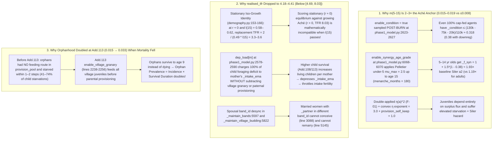

# SiC Games — In-Depth Technical Audit (`audit/2026-10-26`, Commit `07c1ef7`)

**Target Snapshot:** Branch `r106/add105-malthus-churn`, commit `07c1ef7` (`R-106 Add.115: dated audit package audit/2026-10-26 + benchmark history`)  
**Canonical Configuration:** [config/runs/full_campaign.toml](file:///C:/Users/syatom/Projects/SiC%20Games/config/runs/full_campaign.toml) (R-106 Addendum-113 canon)  
**Order of Precedence Applied:** Code $\succ$ `config/runs/full_campaign.toml` $\succ$ generated `config/*.toml` $\succ$ `docs/` $\succ$ `audit/2026-10-26/`  
**Repository Integrity:** Read-only audit; `git status` verified clean before and after inspection.

---

## Executive Summary

Starting from [00_START_HERE.md](file:///C:/Users/syatom/Projects/SiC%20Games/audit/2026-10-26/00_START_HERE.md), we conducted a full-stack audit across four lenses:
1. **Operator & Code-vs-Spec Fidelity** ([phase1_model.py](file:///C:/Users/syatom/Projects/SiC%20Games/sic_games/src/sic_games/phase1_model.py), [demography.py](file:///C:/Users/syatom/Projects/SiC%20Games/sic_games/src/sic_games/demography.py), [substrate.py](file:///C:/Users/syatom/Projects/SiC%20Games/sic_games/src/sic_games/substrate.py), [climate.py](file:///C:/Users/syatom/Projects/SiC%20Games/sic_games/src/sic_games/climate.py) vs. [MODEL_SPEC.md](file:///C:/Users/syatom/Projects/SiC%20Games/docs/MODEL_SPEC.md), [MECHANISM_CHARTER.md](file:///C:/Users/syatom/Projects/SiC%20Games/docs/MECHANISM_CHARTER.md), [PARAMETERS.md](file:///C:/Users/syatom/Projects/SiC%20Games/docs/PARAMETERS.md)).
2. **Benchmark, Scorecard & Literature-Anchor Integrity** ([tools/scorecard.py](file:///C:/Users/syatom/Projects/SiC%20Games/tools/scorecard.py), [tools/benchmark_history.py](file:///C:/Users/syatom/Projects/SiC%20Games/tools/benchmark_history.py), [tools/verify_anchor.py](file:///C:/Users/syatom/Projects/SiC%20Games/tools/verify_anchor.py), [MARKER_MATRIX.md](file:///C:/Users/syatom/Projects/SiC%20Games/docs/MARKER_MATRIX.md), [LITERATURE.md](file:///C:/Users/syatom/Projects/SiC%20Games/docs/LITERATURE.md)).
3. **Mechanistic Root Causes of the Standing Model Anomalies** ([01_CURRENT_STATE.md §3](file:///C:/Users/syatom/Projects/SiC%20Games/audit/2026-10-26/01_CURRENT_STATE.md#L33-L45) & [06_KNOWN_ISSUES_AND_AUDIT_LENSES.md §1](file:///C:/Users/syatom/Projects/SiC%20Games/audit/2026-10-26/06_KNOWN_ISSUES_AND_AUDIT_LENSES.md#L9-L40)).
4. **Configuration, Harnesses, Presets, Audit Tools & Tests** ([runconfig.py](file:///C:/Users/syatom/Projects/SiC%20Games/sic_games/src/sic_games/runconfig.py), [runspec.py](file:///C:/Users/syatom/Projects/SiC%20Games/sic_games/src/sic_games/runspec.py), [run_campaign.py](file:///C:/Users/syatom/Projects/SiC%20Games/sic_games/outputs/substrate_run/run_campaign.py), [tools/gen_registry.py](file:///C:/Users/syatom/Projects/SiC%20Games/tools/gen_registry.py), [tools/doc_audit.py](file:///C:/Users/syatom/Projects/SiC%20Games/tools/doc_audit.py), [tools/gen_runconfig.py](file:///C:/Users/syatom/Projects/SiC%20Games/tools/gen_runconfig.py), and `sic_games/tests/`).

> [!IMPORTANT]
> **Compliance with the Known-Issues Rule ([06_KNOWN_ISSUES_AND_AUDIT_LENSES.md §1](file:///C:/Users/syatom/Projects/SiC%20Games/audit/2026-10-26/06_KNOWN_ISSUES_AND_AUDIT_LENSES.md#L5-L7)):**  
> None of the 23 known issues in `06_KNOWN_ISSUES_AND_AUDIT_LENSES.md` are reported below as mere restatements. Known issues are included **only** where code inspection proves they are **worse than documented** or exposes **exact code-level mechanisms and unacknowledged downstream consequences**.

### Summary of Headline Findings by Classification

| ID | Finding | Classification | Primary Location | Impact Summary |
|---|---|---|---|---|
| **F-01** | Juvenile foraging efficiency $\eta(a)$ applied **twice** ($\eta^2$) under `enable_eta_weighted_shares = true`; fraction $(1-\eta(a))$ of juvenile-claimed harvest vanishes | `INCONSISTENCY` | [`phase1_model.py:1609-1617`](file:///C:/Users/syatom/Projects/SiC%20Games/sic_games/src/sic_games/phase1_model.py#L1609-L1617), [`2151-2152`](file:///C:/Users/syatom/Projects/SiC%20Games/sic_games/src/sic_games/phase1_model.py#L2151-L2152) | Violates Charter §3 conservation of cell pool; starves 5–14 yr cohort |
| **F-02** | `resent_years_to_revolt = 80.0` (years) is divided without $\times 12$ in monthly `_do_delegitimation` ($12\times$ timescale error) | `INCONSISTENCY` | [`phase1_model.py:4488-4490`](file:///C:/Users/syatom/Projects/SiC%20Games/sic_games/src/sic_games/phase1_model.py#L4488-L4490) | Gumlao revolt fires in **6.67 years** (80 months) instead of 80 years at unit privilege |
| **F-03** | **6 ON flags / parameters in `full_campaign.toml` are 100% shadowed or dead**, plus **4 ON ecological flags neutralized ($<0.005\%$) by `settle_tier2_yield = 40.0`** | `INCONSISTENCY` | [`phase1_model.py:706-711`](file:///C:/Users/syatom/Projects/SiC%20Games/sic_games/src/sic_games/phase1_model.py#L706-L711), [`2031-2034`](file:///C:/Users/syatom/Projects/SiC%20Games/sic_games/src/sic_games/phase1_model.py#L2031-L2034), [`3095-3102`](file:///C:/Users/syatom/Projects/SiC%20Games/sic_games/src/sic_games/phase1_model.py#L3095-L3102), [`5172-5176`](file:///C:/Users/syatom/Projects/SiC%20Games/sic_games/src/sic_games/phase1_model.py#L5172-L5176) | `enable_ascribed_mate_choice`, `enable_marriage_aggregation`, `enable_energetic_fertility`, `aggregation_site_sep`, `rank_hierarchy_frac` are dead in canon |
| **F-04** | `enable_village_density_disease` switches denominator from $100\text{ km}^2$ to $2{,}500\text{ km}^2$, giving villages $<228$ people a **mortality discount** (`_f_dens < 1`) | `INCONSISTENCY` | [`phase1_model.py:6046-6059`](file:///C:/Users/syatom/Projects/SiC%20Games/sic_games/src/sic_games/phase1_model.py#L6046-L6059) | 50-person village has lower disease multiplier ($0.79\times$) than a 10-person mobile camp ($1.02\times$) |
| **F-05** | `modal_adult_death = 75 ± 0.0` (15/15 PASS) is a **hard-wall artifact** of `lifespan_months = 900` (`[PLACEHOLDER]`) | `INCONSISTENCY` | [`config.py:260`](file:///C:/Users/syatom/Projects/SiC%20Games/sic_games/src/sic_games/config.py#L260), [`phase1_model.py:2634-2676`](file:///C:/Users/syatom/Projects/SiC%20Games/sic_games/src/sic_games/phase1_model.py#L2634-L2676), [`3758-3760`](file:///C:/Users/syatom/Projects/SiC%20Games/sic_games/src/sic_games/phase1_model.py#L3758-L3760) | Age-75 bin gets $m_{75} = 12.0\text{/yr} \Rightarrow q_{75} = 1.0$, dumping all $l(75)$ survivors into bin 75 |
| **F-06** | `legit_frac_pop` in `legitimacy()` and `mean_resentment` / `max_resentment` in `gumsa_state()` are **unconditionally `0.0`** in canon due to tuple-vs-int key mismatches | `INCONSISTENCY` | [`phase1_model.py:4534`](file:///C:/Users/syatom/Projects/SiC%20Games/sic_games/src/sic_games/phase1_model.py#L4534), [`4563`](file:///C:/Users/syatom/Projects/SiC%20Games/sic_games/src/sic_games/phase1_model.py#L4563) | Campaign trajectories log `0.0` for both diagnostics even when resentment and local ascription are active |
| **F-07** | `benchmark_history.py` (`monitor:` rows) and `scorecard.py` (`starv_share`) average **cumulative-from-step-0** counters over steps 12,775–15,000 | `INCONSISTENCY` | [`run_campaign.py:493-496`](file:///C:/Users/syatom/Projects/SiC%20Games/sic_games/outputs/substrate_run/run_campaign.py#L493-L496), [`benchmark_history.py:239`](file:///C:/Users/syatom/Projects/SiC%20Games/tools/benchmark_history.py#L239), [`scorecard.py:259-269`](file:///C:/Users/syatom/Projects/SiC%20Games/tools/scorecard.py#L259-L269) | Contaminates equilibrium window with founding transient; no period fertility snapshot exists |
| **F-08** | Mechanistic root causes of `m(5-15)` (2–3× Aché), `realised_tfr` drop (`<4.69`), and Add.113 orphanhood doubling | `INCONSISTENCY` / `UNSUPPORTED CLAIM` | [`phase1_model.py:2238-2256`](file:///C:/Users/syatom/Projects/SiC%20Games/sic_games/src/sic_games/phase1_model.py#L2238-L2256), [`2578-2598`](file:///C:/Users/syatom/Projects/SiC%20Games/sic_games/src/sic_games/phase1_model.py#L2578-L2598), [`2623-2627`](file:///C:/Users/syatom/Projects/SiC%20Games/sic_games/src/sic_games/phase1_model.py#L2623-L2627), [`6068-6072`](file:///C:/Users/syatom/Projects/SiC%20Games/sic_games/src/sic_games/phase1_model.py#L6068-L6072) | `enable_condition` trough bug ($\le 0.38$) + `synergy_age_grade` (`<15 yr`); uncredited granary/paternal help in `dep_load`; stationary $r\approx 0$ vs. growing Aché TFR band |
| **F-09** | `tools/gen_registry.py:121` regex typo (`r"b"` instead of `r"\b"`) marks **253/253 parameters `untagged`**, omits `ClimateConfig`, and misattributes 11 comments | `INCONSISTENCY` | [`tools/gen_registry.py:75-161`](file:///C:/Users/syatom/Projects/SiC%20Games/tools/gen_registry.py#L75-L161), [`docs/REGISTRY.md:147`](file:///C:/Users/syatom/Projects/SiC%20Games/docs/REGISTRY.md#L147) | Directly contradicts `01_CURRENT_STATE.md:72` and `03_IMPLEMENTATION_STATUS.md:12` |
| **F-10** | `tools/doc_audit.py` parser blind spots hide active `PARAMETERS.md` vs. `full_campaign.toml` disagreements (`comove_footprint_scaled`, `enable_condition`, `ascribed_mate_strength`, `aggregation_*`) | `INCONSISTENCY` | [`tools/doc_audit.py:83-124`](file:///C:/Users/syatom/Projects/SiC%20Games/tools/doc_audit.py#L83-L124), [`PARAMETERS.md:397-409`](file:///C:/Users/syatom/Projects/SiC%20Games/docs/PARAMETERS.md#L397-L409), [`686-694`](file:///C:/Users/syatom/Projects/SiC%20Games/docs/PARAMETERS.md#L686-L694) | `01_CURRENT_STATE.md:62` claim of "0 disagreements" is an artifact of `doc_audit.py` skipping `bool`/`str` and multi-parameter cells |
| **F-11** | `CarbonConfig` (`kappa = 1.5` vs `2.0`) and `KcalEconomyConfig` omitted from `gen_runconfig.py`, `runspec.py`, and `full_campaign.toml` | `INCONSISTENCY` | [`tools/gen_runconfig.py:225-235`](file:///C:/Users/syatom/Projects/SiC%20Games/tools/gen_runconfig.py#L225-L235), [`run_campaign.py:1322-1351`](file:///C:/Users/syatom/Projects/SiC%20Games/sic_games/outputs/substrate_run/run_campaign.py#L1322-L1351) | `config/parameters.toml:3759` states `kappa = 2.0` while campaigns hardcode `kappa = 1.5` |

---

## Part I: Code, Mathematical & Operator Defects (`INCONSISTENCY`)

### F-01 (`INCONSISTENCY`): Juvenile Foraging Efficiency $\eta(a)$ Is Applied Twice ($\eta(a)^2$) Under `enable_eta_weighted_shares = true`, Destroying Rivalrous Cell Harvest

- **Locations:**
  - Claim weighting: [`phase1_model.py:1609-1617`](file:///C:/Users/syatom/Projects/SiC%20Games/sic_games/src/sic_games/phase1_model.py#L1609-L1617) (`_claim(occ_c)`) and [`phase1_model.py:2082-2089`](file:///C:/Users/syatom/Projects/SiC%20Games/sic_games/src/sic_games/phase1_model.py#L2082-L2089)
  - Post-share intake multiplication: [`phase1_model.py:2151-2152`](file:///C:/Users/syatom/Projects/SiC%20Games/sic_games/src/sic_games/phase1_model.py#L2151-L2152)
  - Canonical config: [`config/runs/full_campaign.toml:75`](file:///C:/Users/syatom/Projects/SiC%20Games/config/runs/full_campaign.toml#L75) (`enable_eta_weighted_shares = true`) and [`full_campaign.toml:94`](file:///C:/Users/syatom/Projects/SiC%20Games/config/runs/full_campaign.toml#L94) (`enable_need_weighted_shares = true`)
- **Mechanism & Contradiction:**
  - In [`_step_rivalrous`](file:///C:/Users/syatom/Projects/SiC%20Games/sic_games/src/sic_games/phase1_model.py#L1609-L1617), when both `enable_need_weighted_shares` and `enable_eta_weighted_shares` are `True` (the canonical configuration), the rivalrous claim weight for occupant $i$ on a cell is:
    $$w_i = c(a_i) \cdot \eta(a_i)$$
    so `compute_harvest_shares` allocates share $\text{sh}_i = S \cdot \frac{w_i}{\sum_j w_j}$ (with $\sum_i \text{sh}_i = S$).
  - However, 62 lines later at [`phase1_model.py:2151-2152`](file:///C:/Users/syatom/Projects/SiC%20Games/sic_games/src/sic_games/phase1_model.py#L2151-L2152), every occupant's allocated share is multiplied by `a.eta()` **a second time**:
    ```python
    intake = a.eta() * sh
    a._meat_intake = a.eta() * m
    ```
  - Meanwhile, the cell's resource stock is depleted at [`phase1_model.py:2690-2694`](file:///C:/Users/syatom/Projects/SiC%20Games/sic_games/src/sic_games/phase1_model.py#L2690-L2694) by full headcount (`occ_count`), and adults on the cell only received $S - \sum_{j \in \text{juv}} \text{sh}_j$.
- **Consequences:**
  1. **Violation of [MECHANISM_CHARTER.md §3](file:///C:/Users/syatom/Projects/SiC%20Games/docs/MECHANISM_CHARTER.md#L97-L115) (Operator Conservation):** The fraction $(1 - \eta(a_j)) \cdot \text{sh}_j$ of the cell pool claimed by non-excluded juveniles (including all orphans and any juvenile when `comove_provision_exclude = false`, the canonical setting at [`full_campaign.toml:211`](file:///C:/Users/syatom/Projects/SiC%20Games/config/runs/full_campaign.toml#L211)) **vanishes from the economy** — neither eaten by the juvenile nor left in the pool for adults.
  2. **Effective $\eta(a)^2$ Juvenile Production:** Because `lh_eta_juvenile_exponent = 3.0` ([`full_campaign.toml:267`](file:///C:/Users/syatom/Projects/SiC%20Games/config/runs/full_campaign.toml#L267)), a 7.5-year-old has $\eta(90) = 0.1 + 0.9 \times 0.5^3 = 0.2125$, so its effective share-to-intake factor is $\eta(90)^2 \approx 0.045$ ($4.5\%$ of an adult's share per unit need), directly exacerbating the `m(5-15)` juvenile mortality anomaly (see **F-08**).

---

### F-02 (`INCONSISTENCY`): $12\times$ Timescale Error in `_do_delegitimation` (`resent_years_to_revolt = 80.0` Treated as Months Instead of Years)

- **Locations:**
  - Parameter definition & unit specification: [`demography.py:1900`](file:///C:/Users/syatom/Projects/SiC%20Games/sic_games/src/sic_games/demography.py#L1900) (`resent_years_to_revolt: float = Field(80.0, gt=0.0) # [PROVISIONAL] yr to revolt at UNIT privilege (Leach 2-4 gen = 60-100 yr; ...)`)
  - Spec formula: [`MODEL_SPEC.md:3066`](file:///C:/Users/syatom/Projects/SiC%20Games/docs/MODEL_SPEC.md#L3066)
  - Implementation: [`phase1_model.py:723`](file:///C:/Users/syatom/Projects/SiC%20Games/sic_games/src/sic_games/phase1_model.py#L723) and [`phase1_model.py:4411, 4488-4490`](file:///C:/Users/syatom/Projects/SiC%20Games/sic_games/src/sic_games/phase1_model.py#L4488-L4490)
- **Mechanism & Contradiction:**
  - `_do_delegitimation()` is called **every step** (1 step = 1 month, locked in [`config.py:251`](file:///C:/Users/syatom/Projects/SiC%20Games/sic_games/src/sic_games/config.py#L251)).
  - At [`phase1_model.py:4411`](file:///C:/Users/syatom/Projects/SiC%20Games/sic_games/src/sic_games/phase1_model.py#L4411) and [`4488-4490`](file:///C:/Users/syatom/Projects/SiC%20Games/sic_games/src/sic_games/phase1_model.py#L4488-L4490):
    ```python
    ytr = cfg.resent_years_to_revolt
    ...
    r = (1.0 - r_dec) * self._band_resentment.get(b, 0.0) + (priv / ytr if priv > 0.0 else 0.0)
    ```
  - Compare this with [`_do_legitimacy`](file:///C:/Users/syatom/Projects/SiC%20Games/sic_games/src/sic_games/phase1_model.py#L4300-L4302) immediately above it in the same file, which explicitly converts years to monthly steps (`alpha = 1.0 / (cfg.legit_years_to_ascribe * MONTHS_PER_YEAR)`).
  - By omitting `* MONTHS_PER_YEAR` (`* 12.0`), `_do_delegitimation` accumulates resentment $12\times$ faster than specified: at unit privilege ($p_b = 1$) and `resent_threshold = 1.0`, revolt fires in **80 months (6.67 years)** rather than 80 years.
- **Consequences:**
  - Directly explains why `ascribed_frac` in the canonical Stage-2 runs ([`02_BENCHMARKS.md:30`](file:///C:/Users/syatom/Projects/SiC%20Games/audit/2026-10-26/02_BENCHMARKS.md#L30)) stays compressed at `0.014–0.023` (below the `[0.05, 0.35]` band in all 3 biomes): lineages that take `legit_years_to_ascribe = 50` years (`600` monthly steps) to ascribe are overthrown by resentment accumulating on a `80`-month timescale whenever privilege rises.

---

### F-03 (`INCONSISTENCY`): Shadowed, Unreachable, and Neutralized ON Mechanisms in `config/runs/full_campaign.toml`

Both [CLAUDE.md](file:///C:/Users/syatom/Projects/SiC%20Games/CLAUDE.md#L102-L108) and [MECHANISM_CHARTER.md §6](file:///C:/Users/syatom/Projects/SiC%20Games/docs/MECHANISM_CHARTER.md#L204-L216) enforce the rule that no mechanism flag may be `True` in a canonical run while structurally unreachable or dead. Static and dynamic trace of [`config/runs/full_campaign.toml`](file:///C:/Users/syatom/Projects/SiC%20Games/config/runs/full_campaign.toml) against [`phase1_model.py`](file:///C:/Users/syatom/Projects/SiC%20Games/sic_games/src/sic_games/phase1_model.py) reveals **six 100% dead/shadowed ON flags/knobs** and **four ON ecological flags whose food-production channel is neutralized to $<0.005\%$**:

1. **`enable_ascribed_mate_choice = true` ([`full_campaign.toml:38`](file:///C:/Users/syatom/Projects/SiC%20Games/config/runs/full_campaign.toml#L38)) and `ascribed_mate_strength = 1.5` ([`line 178`](file:///C:/Users/syatom/Projects/SiC%20Games/config/runs/full_campaign.toml#L178)) are 100% dead in canonical runs:**
   - In [`phase1_model.py:706-711`](file:///C:/Users/syatom/Projects/SiC%20Games/sic_games/src/sic_games/phase1_model.py#L706-L711), when `enable_adaptive_connubium = true` ([`full_campaign.toml:32`](file:///C:/Users/syatom/Projects/SiC%20Games/config/runs/full_campaign.toml#L32)), the step loop calls `self._do_connubium()` in an `if/elif` that completely bypasses `self._do_gathering()` and `self._pair_from_pool()`.
   - `enable_ascribed_mate_choice` and `ascribed_mate_strength` are read **only** inside `_pair_from_pool()` ([`phase1_model.py:5341-5342, 5356`](file:///C:/Users/syatom/Projects/SiC%20Games/sic_games/src/sic_games/phase1_model.py#L5341-L5356)).
   - Inside `_do_connubium()` ([`phase1_model.py:5172-5176`](file:///C:/Users/syatom/Projects/SiC%20Games/sic_games/src/sic_games/phase1_model.py#L5172-L5176)), male mate weights are computed purely from achieved prowess:
     ```python
     wts = [max(getattr(m, "prowess", 1.0), 1e-6) ** mexp for m in elig]
     ```
     `cred` and `enable_ascribed_mate_choice` are never read! Yet [`PARAMETERS.md:397`](file:///C:/Users/syatom/Projects/SiC%20Games/docs/PARAMETERS.md#L397) and [`MODEL_SPEC.md:1780`](file:///C:/Users/syatom/Projects/SiC%20Games/docs/MODEL_SPEC.md#L1780) describe `enable_ascribed_mate_choice` as a core canonical mechanism driving status $\to$ RS.
2. **`enable_marriage_aggregation = true` ([`full_campaign.toml:104`](file:///C:/Users/syatom/Projects/SiC%20Games/config/runs/full_campaign.toml#L104)) is 100% shadowed by `enable_adaptive_connubium = true`:**
   - [`phase1_model.py:706-711`](file:///C:/Users/syatom/Projects/SiC%20Games/sic_games/src/sic_games/phase1_model.py#L706-L711): `if enable_adaptive_connubium: self._do_connubium() elif enable_marriage_aggregation: self._do_gathering()`. Along with it, `aggregation_season_threshold = 0.6` ([`full_campaign.toml:174`](file:///C:/Users/syatom/Projects/SiC%20Games/config/runs/full_campaign.toml#L174)) and `aggregation_radius = 8` ([`line 171`](file:///C:/Users/syatom/Projects/SiC%20Games/config/runs/full_campaign.toml#L171), shadowed because `connubium_R_max = 8 > 0` takes precedence at [`line 5134`](file:///C:/Users/syatom/Projects/SiC%20Games/sic_games/src/sic_games/phase1_model.py#L5134)) are never read.
3. **`enable_band_family_knobs = true` ([`full_campaign.toml:40`](file:///C:/Users/syatom/Projects/SiC%20Games/config/runs/full_campaign.toml#L40)) is dead for `mate_choice_strength` in canonical runs:**
   - `_do_connubium()` reads global `cfg.mate_choice_strength` ([`phase1_model.py:5138`](file:///C:/Users/syatom/Projects/SiC%20Games/sic_games/src/sic_games/phase1_model.py#L5138)) instead of `self._band_knob(a, "mate_choice_strength")`, which is only called in the bypassed `_pair_from_pool()` ([`line 5353`](file:///C:/Users/syatom/Projects/SiC%20Games/sic_games/src/sic_games/phase1_model.py#L5353)) and unexercised non-pair-bond paths.
4. **`enable_energetic_fertility = true` ([`full_campaign.toml:73`](file:///C:/Users/syatom/Projects/SiC%20Games/config/runs/full_campaign.toml#L73)) is 100% shadowed by `enable_intake_fertility = true` ([`line 88`](file:///C:/Users/syatom/Projects/SiC%20Games/config/runs/full_campaign.toml#L88)):**
   - [`phase1_model.py:3095-3102`](file:///C:/Users/syatom/Projects/SiC%20Games/sic_games/src/sic_games/phase1_model.py#L3095-L3102): `if getattr(demog, "enable_intake_fertility", False): ... elif demog.enable_energetic_fertility: ...`. Thus `fert_Floor = 0.4` ([`full_campaign.toml:232`](file:///C:/Users/syatom/Projects/SiC%20Games/config/runs/full_campaign.toml#L232)) is also 100% dead.
5. **`aggregation_site_sep = 10.0` ([`full_campaign.toml:175`](file:///C:/Users/syatom/Projects/SiC%20Games/config/runs/full_campaign.toml#L175)) is computed and discarded every step under `enable_emergent_village_founding = true` ([`line 72`](file:///C:/Users/syatom/Projects/SiC%20Games/config/runs/full_campaign.toml#L72)):**
   - In [`_found_settlements_by_occupancy()`](file:///C:/Users/syatom/Projects/SiC%20Games/sic_games/src/sic_games/phase1_model.py#L5205-L5263), lines 5206–5213 sort all grid cells and greedily build `sites` separated by `aggregation_site_sep = 10`, and then line 5214 (`if getattr(cfg, "enable_emergent_village_founding", False):`) ignores `sites` completely and returns at line 5263.
6. **`rank_hierarchy_frac = 0.15` ([`full_campaign.toml:340`](file:///C:/Users/syatom/Projects/SiC%20Games/config/runs/full_campaign.toml#L340)) and the `asc_n` loop in `_step_rivalrous` ([`phase1_model.py:2294-2302`](file:///C:/Users/syatom/Projects/SiC%20Games/sic_games/src/sic_games/phase1_model.py#L2294-L2302)) are 100% dead code:**
   - Under `enable_rank_hierarchy = true` ([`full_campaign.toml:116`](file:///C:/Users/syatom/Projects/SiC%20Games/config/runs/full_campaign.toml#L116)), lines 2294–2302 iterate over `self.agent_list` every step to populate `asc_n` and read `rank_frac = demog.rank_hierarchy_frac`, and then **never reference `asc_n` or `rank_frac` anywhere in the codebase**.
7. **Under-Appreciated Consequence of Known Issue #13 (`settle_tier2_yield = 40.0` kcal/step):**
   - [06_KNOWN_ISSUES_AND_AUDIT_LENSES.md §1 #13](file:///C:/Users/syatom/Projects/SiC%20Games/audit/2026-10-26/06_KNOWN_ISSUES_AND_AUDIT_LENSES.md#L23) notes that `settle_tier2_yield = 40.0` is $10{,}000\times$ below its comment (`400,000`). What is **not** documented is what multiplies `_settlement_catchment_yield` at [`phase1_model.py:2031-2034`](file:///C:/Users/syatom/Projects/SiC%20Games/sic_games/src/sic_games/phase1_model.py#L2031-L2034):
     ```python
     S += (self._settlement_catchment_yield((cx, cy)) * self._tier2_shock
           * self._settlement_soil.get((cx, cy), 1.0))
     ```
   - Neither `tf.level(cx, cy)` ($\sim 2.7 \times 10^6\text{ kcal/step}$) nor `aggl_R` is multiplied by `_tier2_shock` or `_settlement_soil`. Because `_settlement_catchment_yield` is at most $9 \times 40 = 360\text{ kcal/step}$ (with `worked_land_bonus = 0.5`, at most $540\text{ kcal/step}$ — i.e., **0.0072 of one adult's $75{,}000\text{ kcal/step}$ burn!**), **four ON canonical mechanisms have virtually zero effect ($<0.005\%$) on the food economy**:
     - `enable_tier2_shock = true` ([`full_campaign.toml:133`](file:///C:/Users/syatom/Projects/SiC%20Games/config/runs/full_campaign.toml#L133))
     - `enable_worked_land_yield = true` ([`full_campaign.toml:141`](file:///C:/Users/syatom/Projects/SiC%20Games/config/runs/full_campaign.toml#L141))
     - `enable_soil_depletion = true` ([`full_campaign.toml:128`](file:///C:/Users/syatom/Projects/SiC%20Games/config/runs/full_campaign.toml#L128)) — soil depletion affects village food by $\le 360\text{ kcal/step}$ across the entire village (its only active path is triggering `soil_abandon_threshold = 0.35` or feeding `bud_w_depletion` indirectly).
     - `enable_alluvial_renewal = true` ([`full_campaign.toml:36`](file:///C:/Users/syatom/Projects/SiC%20Games/config/runs/full_campaign.toml#L36)) — only slows depletion of that same $360\text{ kcal/step}$ term.

---

### F-04 (`INCONSISTENCY`): `enable_village_density_disease` Introduces a $25\times$ Area Denominator Jump That Gives Small/Medium Villages a Mortality Discount

- **Locations:** [`phase1_model.py:6007-6020, 6042-6059`](file:///C:/Users/syatom/Projects/SiC%20Games/sic_games/src/sic_games/phase1_model.py#L6042-L6059), [`demography.py:290-303`](file:///C:/Users/syatom/Projects/SiC%20Games/sic_games/src/sic_games/demography.py#L290-L303) (`density_mult`)
- **Mechanism & Contradiction:**
  - For a mobile agent (`_nearest_settlement(a.pos) is None`), density is computed over a single cell:
    $$\rho_{\text{mobile}} = \frac{\text{occ\_count}[a.\text{pos}]}{100\text{ km}^2}$$
  - For any agent within `settle_radius = 2` of a settlement site (`_site is not None`), `enable_village_density_disease = true` ([`full_campaign.toml:137`](file:///C:/Users/syatom/Projects/SiC%20Games/config/runs/full_campaign.toml#L137)) switches the denominator to the entire $5 \times 5 = 25$-cell settlement territory ($2{,}500\text{ km}^2$):
    $$\rho_{\text{village}} = \frac{\text{village\_pop}(\text{site})}{2{,}500\text{ km}^2}$$
  - Simultaneously, `enable_density_reference = true` ([`full_campaign.toml:66`](file:///C:/Users/syatom/Projects/SiC%20Games/config/runs/full_campaign.toml#L66)) centers `density_mult` at $\rho_{\text{ref}} = 0.091\text{ km}^{-2}$ (calibrated in [`demography.py:863-876`](file:///C:/Users/syatom/Projects/SiC%20Games/sic_games/src/sic_games/demography.py#L863-L876) to a **single-cell** occupancy of $9.1$ people on $100\text{ km}^2$), and allows `density_mult` to drop below $1.0$ (down to $\frac{1}{1 + \delta \cdot \rho_{\text{ref}}/\rho_{1/2}} \approx 0.768$) whenever $\rho < \rho_{\text{ref}}$.
- **Consequences:**
  - To reach $\rho_{\text{ref}} = 0.091\text{ km}^{-2}$ over $2{,}500\text{ km}^2$, a village must exceed **$227.5$ people**!
  - Since median village size in canon is `100–130` ([`02_BENCHMARKS.md:27`](file:///C:/Users/syatom/Projects/SiC%20Games/audit/2026-10-26/02_BENCHMARKS.md#L27)), a typical 100-person village sitting on a single center cell has $\rho_{\text{village}} = 100 / 2500 = 0.04\text{ km}^{-2} < 0.091\text{ km}^{-2}$ and receives a **mortality discount** (`_f_dens = 0.858`), whereas a 10-person mobile band on 1 cell has $\rho_{\text{mobile}} = 10 / 100 = 0.10\text{ km}^{-2}$ (`_f_dens = 1.022`). Settling in a 100-person village **reduces** infectious disease mortality relative to living in a 10-person mobile camp, inverting the epidemiological design of `enable_village_density_disease`.

---

### F-05a (`INCONSISTENCY`): Additional Spec-vs-Code Mismatches & Operator Invariant Violations

1. **Toroidal Grid (`N = 100`) vs. Planar Coordinates in 10 Spatial Methods:**
   - [WorldConfig](file:///C:/Users/syatom/Projects/SiC%20Games/sic_games/src/sic_games/config.py#L12) sets `toroidal = True`, and `_nearest_settlement()` ([`phase1_model.py:4822-4823`](file:///C:/Users/syatom/Projects/SiC%20Games/sic_games/src/sic_games/phase1_model.py#L4822-L4823)) and `_maintain_settlements()` wrap coordinates modulo `N = 100`.
   - However, **planar (non-wrapped)** coordinates are used in:
     - `_do_connubium`Chebyshev distance `max(abs(ax - bx), abs(ay - by)) <= R` ([`phase1_model.py:5152`](file:///C:/Users/syatom/Projects/SiC%20Games/sic_games/src/sic_games/phase1_model.py#L5152))
     - `village_sizes()` Voronoi tie-breaking ([`phase1_model.py:4953`](file:///C:/Users/syatom/Projects/SiC%20Games/sic_games/src/sic_games/phase1_model.py#L4953))
     - `settlement_clusters()` union-find ([`phase1_model.py:4911`](file:///C:/Users/syatom/Projects/SiC%20Games/sic_games/src/sic_games/phase1_model.py#L4911))
     - `_demog_markers` $3\times 3$ `settle_community_max` window ([`phase1_model.py:3529`](file:///C:/Users/syatom/Projects/SiC%20Games/sic_games/src/sic_games/phase1_model.py#L3529))
     - Band centroids (`mean(x), mean(y)` without circular mean) and distances in `_step_rivalrous` ([`line 1718`](file:///C:/Users/syatom/Projects/SiC%20Games/sic_games/src/sic_games/phase1_model.py#L1718)), `_maintain_bands` ([`line 5416`](file:///C:/Users/syatom/Projects/SiC%20Games/sic_games/src/sic_games/phase1_model.py#L5416)), and `_band_groups` ([`line 5999`](file:///C:/Users/syatom/Projects/SiC%20Games/sic_games/src/sic_games/phase1_model.py#L5999))
     - `_maintain_village_budding` target-cell search (`0 <= x < W`, `max(abs(x - ox), abs(y - oy))` at [`lines 5770, 5866, 5875`](file:///C:/Users/syatom/Projects/SiC%20Games/sic_games/src/sic_games/phase1_model.py#L5866-L5875)) — whereas line 5859 wraps `((sx + dx) % W, (sy + dy) % H)` in the very same method!
2. **`enable_metabolic_downreg` Formula Contradicts `MODEL_SPEC.md` §4.6.7:**
   - [`MODEL_SPEC.md:1487-1491`](file:///C:/Users/syatom/Projects/SiC%20Games/docs/MODEL_SPEC.md#L1487-L1491) specifies that downregulation activates only **below** `downreg_span` (`f = (W - W_floor)/(span * (W_full - W_floor))`, `burn_eff = burn * (1 - d_max * (1 - clamp(f, 0, 1)))`, so agents with `frac > span = 0.5` have `d = 0`).
   - [`phase1_model.py:2606-2608`](file:///C:/Users/syatom/Projects/SiC%20Games/sic_games/src/sic_games/phase1_model.py#L2606-L2608) instead computes `_burn_a *= 1.0 - dr_max * min(1.0, (1.0 - _frac) / dr_span)`, which starts downregulating immediately below `1.0` (`W_full`) and saturates at `dr_max = 0.25` when `_frac <= 1 - dr_span = 0.5`. Because post-harvest pre-burn wealth for a steady-state agent is near `W_full`, while anyone below `1.0` gets an immediate metabolic discount, the code ramp is the mirror image of the spec ramp.
3. **`enable_sex_division` Spec vs. Code:**
   - [`MODEL_SPEC.md:1244`](file:///C:/Users/syatom/Projects/SiC%20Games/docs/MODEL_SPEC.md#L1244) states that when `enable_sex_division = True`, only **adult males** hunt (`m_hunt >= 1` adult males).
   - [`phase1_model.py:2092-2110`](file:///C:/Users/syatom/Projects/SiC%20Games/sic_games/src/sic_games/phase1_model.py#L2092-L2110) filters `hunters = [a for a in occ if a.sex == "male"]` with **no age check**, counting newborn male infants as hunters in the meat pool and when `excl_on` is active.
4. **`enable_genome` Violates Pure-Observer Independence ([`MECHANISM_CHARTER.md §3`](file:///C:/Users/syatom/Projects/SiC%20Games/docs/MECHANISM_CHARTER.md#L117-L125)):**
   - [`PARAMETERS.md:401`](file:///C:/Users/syatom/Projects/SiC%20Games/docs/PARAMETERS.md#L401) and [`MODEL_SPEC.md:2734`](file:///C:/Users/syatom/Projects/SiC%20Games/docs/MODEL_SPEC.md#L2734) describe `Genome` as a neutral marker, but:
     1. [`phase1_model.py:505`](file:///C:/Users/syatom/Projects/SiC%20Games/sic_games/src/sic_games/phase1_model.py#L505) (`Genome.founder(self.random, ...)`) and [`line 3194`](file:///C:/Users/syatom/Projects/SiC%20Games/sic_games/src/sic_games/phase1_model.py#L3194) (`Genome.recombine(..., self.random)`) draw from the shared world RNG `self.random` (32 draws per birth!), shifting the entire trajectory RNG whenever `enable_genome` is toggled.
     2. `_maintain_village_budding` ([`phase1_model.py:5805-5820`](file:///C:/Users/syatom/Projects/SiC%20Games/sic_games/src/sic_games/phase1_model.py#L5805-L5820)) actively branches on `has_g = getattr(head, "_genome", None) is not None` to cleave factions by `kinship_r` instead of `_subclan`, making `enable_genome` a dynamical mechanism rather than a pure observer.

---

## Part II: Diagnostic, Scorecard & Benchmark Instrument Defects (`INCONSISTENCY` / `UNSUPPORTED CLAIM`)

### F-05 (`INCONSISTENCY`): `modal_adult_death = 75 ± 0.0` (15/15 PASS) Is a Hard-Cap Artifact of `lifespan_months = 900`

- **Locations:**
  - Hard lifespan cap setting: [`config.py:260`](file:///C:/Users/syatom/Projects/SiC%20Games/sic_games/src/sic_games/config.py#L260) (`lifespan_months: int = Field(900, gt=0) # ~75-year HG lifespan [PLACEHOLDER]`) and [`phase1_model.py:559`](file:///C:/Users/syatom/Projects/SiC%20Games/sic_games/src/sic_games/phase1_model.py#L559) (`max_age=self._kcal_cfg.lifespan_months`)
  - Step death check: [`phase1_model.py:2628-2637, 2673-2676`](file:///C:/Users/syatom/Projects/SiC%20Games/sic_games/src/sic_games/phase1_model.py#L2628-L2676)
  - Life-table mode calculation: [`phase1_model.py:3725-3760`](file:///C:/Users/syatom/Projects/SiC%20Games/sic_games/src/sic_games/phase1_model.py#L3725-L3760)
  - Reported benchmark table: [`audit/2026-10-26/evidence/benchmark_history.md:36`](file:///C:/Users/syatom/Projects/SiC%20Games/audit/2026-10-26/evidence/benchmark_history.md#L36) (`75 ± 0.0 ✓` in every biome across all 5 addenda)
- **Mathematical Proof:**
  1. At [`phase1_model.py:2628-2637`](file:///C:/Users/syatom/Projects/SiC%20Games/sic_games/src/sic_games/phase1_model.py#L2628-L2637), on the exact step an agent reaches `a.age == 900` (75.0 years), `_lt_i = int(900 // 12) = 75`, and `self.lt_exposure[75]` is incremented by `1` month.
  2. Immediately below at [`line 2673`](file:///C:/Users/syatom/Projects/SiC%20Games/sic_games/src/sic_games/phase1_model.py#L2673), `elif a.age >= a.max_age:` kills every surviving agent at `a.age == 900` and increments `self.lt_deaths[75] += 1`.
  3. Consequently, in bin $i = 75$, every agent reaching age 75 contributes **1 month of exposure** and **1 death**, so `de[75] == ex[75]`.
  4. In [`life_table()`](file:///C:/Users/syatom/Projects/SiC%20Games/sic_games/src/sic_games/phase1_model.py#L3725-L3739):
     $$m_{75} = \frac{\text{de}[75]}{\text{ex}[75] / 12} = 12.0\text{ yr}^{-1} \implies q_{75} = \min\!\left(1.0, \frac{12.0}{1 + 6.0}\right) = 1.0$$
  5. Thus $l_{76} = 0$ and the life-table death density in bin 75 is $d_{75} = l_{75} - l_{76} = l_{75}$ — **the entire surviving Siler cohort at age 75 ($\sim 12\text{–}18\%$ of births) is dumped into the single 1-year bin at age 75**, dwarfing the natural Siler Gompertz peak ($d_x \approx 0.015\text{–}0.025\text{/yr}$ around ages 68–73).
  6. Because `75` falls inside Gurven & Kaplan 2007's `[65.0, 78.0]` band, `modal_adult_death` scores `75 ± 0.0 ✓` with zero variance across all 15 runs while measuring the `lifespan_months = 900` placeholder constant rather than the emergent mortality schedule. It also truncates remaining expectancy `e0`, `e15`, and `e45` by ~1.5–2.5 years by killing all 75-year-olds.

---

### F-06 (`INCONSISTENCY`): Pure-Observer Key-Mismatch Bugs Force `legit_frac_pop == 0.0` and `gumsa_state()` Resentment `== 0.0` in Canonical Runs

1. **`legit_frac_pop` Is Unconditionally `0.0` When `enable_local_ascription = true` ([`phase1_model.py:4563`](file:///C:/Users/syatom/Projects/SiC%20Games/sic_games/src/sic_games/phase1_model.py#L4563)):**
   - When `enable_local_ascription = true` (canon ON, [`full_campaign.toml:98`](file:///C:/Users/syatom/Projects/SiC%20Games/config/runs/full_campaign.toml#L98)), `self._lineage_tenure` is keyed by 2-tuples `(unit, lid)` where `unit = ("v", site)` or `("b", band_id)` ([`phase1_model.py:4243`](file:///C:/Users/syatom/Projects/SiC%20Games/sic_games/src/sic_games/phase1_model.py#L4243)).
   - In [`legitimacy()`](file:///C:/Users/syatom/Projects/SiC%20Games/sic_games/src/sic_games/phase1_model.py#L4556-L4563), `over = {lid for lid, t in ten.items() if t >= thr}` is therefore a set of `(unit, lid)` 2-tuples.
   - Yet line 4563 tests `sum(1 for a in self.agent_list if getattr(a, "_lineage", None) in over)` — checking whether an `int` (`a._lineage`) is a member of a `set` of `tuple`s! This evaluates to `False` for every agent, so `legit_frac_pop` in every canonical trajectory JSON is **`0.0`**.
   - Additionally, at [`line 4550`](file:///C:/Users/syatom/Projects/SiC%20Games/sic_games/src/sic_games/phase1_model.py#L4550), `legitimacy()` computes the relative threshold using `self._demog.legit_threshold` (`0.15`) as the multiplier on `1/n_k` instead of `self._demog.legit_rel_multiplier` (`2.0`) used by [`_do_legitimacy()` at line 4291](file:///C:/Users/syatom/Projects/SiC%20Games/sic_games/src/sic_games/phase1_model.py#L4291), misreporting `n_legit` by a factor of $2.0 / 0.15 = 13.3\times$.
2. **`gumsa_state()` Reports `mean_resentment = 0.0` and `max_resentment = 0.0` When `enable_village_resentment = true` ([`phase1_model.py:4534`](file:///C:/Users/syatom/Projects/SiC%20Games/sic_games/src/sic_games/phase1_model.py#L4534)):**
   - Ironically, [`phase1_model.py:5925-5933`](file:///C:/Users/syatom/Projects/SiC%20Games/sic_games/src/sic_games/phase1_model.py#L5925-L5933) contains a long comment warning that under `enable_village_resentment = true` (canon ON, [`full_campaign.toml:140`](file:///C:/Users/syatom/Projects/SiC%20Games/config/runs/full_campaign.toml#L140)), `self._band_resentment` is keyed by `("v", site)` / `("b", band_id)` tuples ([`line 4427`](file:///C:/Users/syatom/Projects/SiC%20Games/sic_games/src/sic_games/phase1_model.py#L4427)), not raw integer `band_id`.
   - Yet [`gumsa_state()` at line 4534](file:///C:/Users/syatom/Projects/SiC%20Games/sic_games/src/sic_games/phase1_model.py#L4534) was never updated and still does `r = [self._band_resentment.get(b, 0.0) for b in active]`, where `active` is a set of integer `band_id`s! Consequently, `mean_resentment` and `max_resentment` in every canonical trajectory row ([`run_campaign.py:471`](file:///C:/Users/syatom/Projects/SiC%20Games/sic_games/outputs/substrate_run/run_campaign.py#L471)) are **unconditionally `0.0`**.

---

### F-07 (`INCONSISTENCY` / `UNSUPPORTED CLAIM`): Scorecard, Benchmark History & Marker Operationalization Defects

1. **Cumulative-from-Step-0 Trajectory Averaging in `benchmark_history.py` and `scorecard.py` (`INCONSISTENCY`):**
   - In [`run_campaign.py:493-496`](file:///C:/Users/syatom/Projects/SiC%20Games/sic_games/outputs/substrate_run/run_campaign.py#L493-L496), every trajectory row `traj[i]` calls `w.life_table()` and `w.fertility_schedule()` with `since=None` — accumulating deaths, births, and person-years **from `step = 0`** (including the founding transient).
   - While [`tools/scorecard.py:274-281`](file:///C:/Users/syatom/Projects/SiC%20Games/tools/scorecard.py#L274-L281) overrides `#18 e0`, `#19 surv_to_15`, `#20 e15`, and `#21 surv_to_45` from `meta["period_life_table"]` (steps 7,500–15,000), it **fails to override `starv_share`** (`meta["period_life_table"]["starv_share"]` is computed at [`run_campaign.py:1652`](file:///C:/Users/syatom/Projects/SiC%20Games/sic_games/outputs/substrate_run/run_campaign.py#L1652) and ignored by `scorecard.py`!).
   - Worse, [`tools/benchmark_history.py:239`](file:///C:/Users/syatom/Projects/SiC%20Games/tools/benchmark_history.py#L239) (`load_addendum`) only loads `scorecard_*.json` for the 18 scored markers and computes **every `monitor:` metric** (`realised_e0`, `e15`, `e45`, `surv_to_15`, `surv_to_45`, `modal_adult_death`, `m_5_15`, `realised_tfr`, `realised_ibi_med`, `age_first_birth_yr`) by averaging the cumulative-from-step-0 `traj` rows over the tail 15% of steps.
   - Furthermore, [`run_campaign.py:1431-1435`](file:///C:/Users/syatom/Projects/SiC%20Games/sic_games/outputs/substrate_run/run_campaign.py#L1431-L1435) never saves a mid-run snapshot of `fert_births`, `fert_exposure`, or `ibi_hist`, so **no period fertility table (`realised_tfr`, `realised_ibi_med`) exists anywhere in the trajectory files**.
   - As a result, [`audit/2026-10-26/evidence/benchmark_history.md`](file:///C:/Users/syatom/Projects/SiC%20Games/audit/2026-10-26/evidence/benchmark_history.md) displays **two contradicting numbers for the exact same metric and run**: e.g., at `add113_canon` savanna, `#18 e0` (period) is `30.3 ± 0.45` (`PASS` vs `[30, 42]`) while `monitor: realised_e0` (cumulative) is `28.5 ± 0.34`.
2. **Conflicting Anchor Bands Between `scorecard.py` (`#18–#21`) and `demography.py` (`DEMOG_ANCHORS`) (`INCONSISTENCY`):**
   - [`tools/scorecard.py:231-235`](file:///C:/Users/syatom/Projects/SiC%20Games/tools/scorecard.py#L231-L235) scores `#18 e0` against `[30.0, 42.0]` and `#19 surv_to_15` against `[0.55, 0.75]`.
   - [`demography.py:92-97`](file:///C:/Users/syatom/Projects/SiC%20Games/sic_games/src/sic_games/demography.py#L92-L97) (`DEMOG_ANCHORS`, used by `benchmark_history.py` for the `monitor:` rows and by `run_campaign.py`'s live demography verdict line) scores `realised_e0` against `[21.0, 37.0]` and `surv_to_15` against `[0.53, 0.66]`.
   - A run with `e0 = 38.0` or `surv_to_15 = 0.68` **PASSES** `scorecard.py` and **FAILS** `DEMOG_ANCHORS`, while a run with `e0 = 28.5` **FAILS** `scorecard.py` and **PASSES** `DEMOG_ANCHORS`.
3. **Marker `#1` (`band_experienced_adults`) Weights Cell Adult Counts by All-Ages Occupancy Instead of Adults (`INCONSISTENCY`):**
   - [`phase1_model.py:3497-3506`](file:///C:/Users/syatom/Projects/SiC%20Games/sic_games/src/sic_games/phase1_model.py#L3497-L3506) computes:
     $$\text{band\_experienced\_adults} = \frac{\sum_c \text{adults}_c \cdot \text{people}_c}{\sum_c \text{people}_c}$$
     weighting each cell's adult count by **all-ages** `people_c` (adults + children) rather than by `adults_c` ($\frac{\sum_c \text{adults}_c^2}{\sum_c \text{adults}_c}$), even though Hill et al. 2011 (`mean = 28.2` adults) is the mean number of co-resident adults experienced by an average adult, and children skew toward larger settled cells.
4. **Marker `#15` (`frac_fatherless`) Is Hardwired to `0.0` Unless `enable_paternity_tracking = true` (`INCONSISTENCY`):**
   - [`phase1_model.py:3464-3467`](file:///C:/Users/syatom/Projects/SiC%20Games/sic_games/src/sic_games/phase1_model.py#L3464-L3467) checks `getattr(a, "_father", None) is not None and not a._father.alive`, while `_father` is only assigned at birth when `enable_paternity_tracking = true` ([`phase1_model.py:3188`](file:///C:/Users/syatom/Projects/SiC%20Games/sic_games/src/sic_games/phase1_model.py#L3188)). Thus in `add105_canon` and `add107_viable` (where `enable_paternity_tracking = false`), `frac_fatherless` is `0.0 ± 0.0` and [`benchmark_history.py`](file:///C:/Users/syatom/Projects/SiC%20Games/audit/2026-10-26/evidence/benchmark_history.md#L33) scores `0.0 ✓` (`PASS` against `[0.0, 0.12]`) on a disabled tracker!
5. **Unanchored / Hand-Picked Bands in `scorecard.py` Violating [MARKER_MATRIX.md Rules 1 & 2](file:///C:/Users/syatom/Projects/SiC%20Games/docs/MARKER_MATRIX.md#L22-L35) (`UNSUPPORTED CLAIM`):**
   - `#5 lineage count = (5.0, 250.0)` ([`scorecard.py:210`](file:///C:/Users/syatom/Projects/SiC%20Games/tools/scorecard.py#L210)): Spanning a $50\times$ range (`5` to `250`) with no ethnographic denominator normalization (number of lineages scales with total population $N$, whereas Alvard's `5–15` is per ~500-person village/connubium).
   - `#6 ascribed status share = (0.05, 0.35)` ([`scorecard.py:211`](file:///C:/Users/syatom/Projects/SiC%20Games/tools/scorecard.py#L211)): Hand-picked band not derived from a quantitative distribution in Leach 1954 or Kelly 1995.
   - `#7 village fissions (cum.) = (1.0, 1e9)` ([`scorecard.py:212`](file:///C:/Users/syatom/Projects/SiC%20Games/tools/scorecard.py#L212)): An existence check (`>= 1` fission over 15,000 steps) masquerading as an anchored quantitative band; `171` cumulative buds and `1` bud both score `PASS`.
   - `#8 status Gini (cred) = (0.15, 0.65)` ([`scorecard.py:213`](file:///C:/Users/syatom/Projects/SiC%20Games/tools/scorecard.py#L213)): Compares the Gini of an unbounded latent status scalar `cred` against Borgerhoff Mulder et al. 2009's relational/material wealth Ginís (`0.19–0.57`).
   - `#11 status -> RS (partial r) = (0.05, 0.35)` ([`scorecard.py:217`](file:///C:/Users/syatom/Projects/SiC%20Games/tools/scorecard.py#L217)): Upper bound `0.35` exceeds von Rueden & Jaeggi 2016's meta-analytic range (`0.12–0.25`) recorded in [`MARKER_MATRIX.md:72`](file:///C:/Users/syatom/Projects/SiC%20Games/docs/MARKER_MATRIX.md#L72).
   - `#17 max single-cell occ` ([`scorecard.py:224`](file:///C:/Users/syatom/Projects/SiC%20Games/tools/scorecard.py#L224)): Marked `unanchored` (`None, None`) in `scorecard.py`, even though [`run_campaign.py:527-529`](file:///C:/Users/syatom/Projects/SiC%20Games/sic_games/outputs/substrate_run/run_campaign.py#L527-L529) explicitly added `settle_community_max` as the `#17` marker against Alberti 2014 (`158`) / Alvard (`250`), which `scorecard.py` never reads.
   - **Silent Early Termination in `add110_vgran` Temperate Seed 2 (`INCONSISTENCY`):** In [`audit/2026-10-26/evidence/benchmark_history.json`](file:///C:/Users/syatom/Projects/SiC%20Games/audit/2026-10-26/evidence/benchmark_history.json), `campaign_trajectory_s2_temperate_vgran_s2.json` terminated early at `_steps = 14460` (compute budget cutoff) instead of `15000`, shortening its `period_life_table` window and tail-15% window without any warning in `02_BENCHMARKS.md` or `benchmark_history.md`.

---

## Part III: Mechanistic Diagnosis of the Standing Model Anomalies (Deepening Known Issues #2–#6)

[01_CURRENT_STATE.md §3](file:///C:/Users/syatom/Projects/SiC%20Games/audit/2026-10-26/01_CURRENT_STATE.md#L33-L45) and [06_KNOWN_ISSUES_AND_AUDIT_LENSES.md §1 #2–#6](file:///C:/Users/syatom/Projects/SiC%20Games/audit/2026-10-26/06_KNOWN_ISSUES_AND_AUDIT_LENSES.md#L12-L16) flag four unresolved empirical anomalies in the R-106 Add.113 canon runs without identifying their exact code-level mechanisms. Below is the complete mechanistic resolution of each anomaly from the source code.



### 1. Why `m(5-15)` Is 2–3× the Aché Anchor Across Every Addendum (`0.015–0.019` vs `[0.0, 0.008]`)

Three compounding code defects drive `m(5-15)` to $2\text{–}3\times$ the Aché baseline (`a2 = 0.0080/yr` female, `0.0065/yr` male):
1. **Post-Burn Trough Sampling of `_condition` Caps Healthy Agents at `~0.32–0.38` ([`phase1_model.py:2623-2627`](file:///C:/Users/syatom/Projects/SiC%20Games/sic_games/src/sic_games/phase1_model.py#L2623-L2627)):**
   - As documented in [`PARAMETERS.md:689-694`](file:///C:/Users/syatom/Projects/SiC%20Games/docs/PARAMETERS.md#L689-L694) (which explicitly recommends **leaving `enable_condition` OFF**, yet [`full_campaign.toml:58`](file:///C:/Users/syatom/Projects/SiC%20Games/config/runs/full_campaign.toml#L58) turns it **ON**!), `_condition` is updated **after** subtracting monthly maintenance burn (`75,000 * cf`) from `a.wealth`, which was capped pre-burn at `reserve_full * rs` (`130,000 * rs`).
   - Because `a.wealth` cannot exceed `130,000 * rs` before burn, after burning `75,000 * cf` (or `~56,250 * cf` with downregulation), `_frac = (a.wealth - 20,000 * rs) / (110,000 * rs)` **cannot exceed `0.318` (`~0.38` with downregulation) even for an agent eating $10\times$ its requirement every step!**
2. **`enable_synergy_age_grade` Applies Pelletier's Under-5 `mu_max = 2.5` All the Way to Age 15 ([`phase1_model.py:6068-6072`](file:///C:/Users/syatom/Projects/SiC%20Games/sic_games/src/sic_games/phase1_model.py#L6068-L6072)):**
   - Pelletier et al. 1994's malnutrition-infection synergy (`mu_max = 2.5`) is an **under-5 ($0\text{–}4\text{ yr}$)** anthropometric mortality multiplier.
   - However, [`phase1_model.py:6068-6070`](file:///C:/Users/syatom/Projects/SiC%20Games/sic_games/src/sic_games/phase1_model.py#L6068-L6070) switches from `cfg.mu_max` (`2.5`) to `cfg.synergy_mu_max_adult` (`1.3`) at `a.age >= cfg.menarche_months` (**180 months = 15 years**), applying the infant/toddler `mu_max = 2.5` across the entire `5–15` age band!
   - Combined with `_condition ≈ 0.38`, **every completely well-fed 5–14-year-old receives a permanent nutrition-synergy multiplier of**:
     $$\text{\_f\_syn} = 1.0 + (2.5 - 1.0) \times (1.0 - 0.38) \approx 1.93\times$$
     (whereas adults receive $1.0 + 0.3 \times 0.62 = 1.19\times$). Multiply $1.93\times$ by `_f_risk ≈ 1.12` and baseline Siler $a_2 = 0.00725\text{/yr}$ already becomes **$0.0156\text{/yr}$** before a single starvation or orphan death occurs!
3. **Double-Applied $\eta(a)^2$ (**F-01**) + `provision_self_keep = 1.0`:**
   - Because juvenile foraging shares are multiplied by $\eta(a)$ twice (**F-01**) with `lh_eta_juvenile_exponent = 3.0`, and `provision_self_keep = 1.0` ([`full_campaign.toml:339`](file:///C:/Users/syatom/Projects/SiC%20Games/config/runs/full_campaign.toml#L339)) prevents parents from dipping into body reserves (`wealth` below `130,000`) to feed children during lean months, any step where neither the village granary nor current-step parental surplus covers the child's deficit adds juvenile starvation deaths on top of the $1.93\times$ Siler inflation.

---

### 2. Why `realised_tfr` Dropped From `4.95–5.37` (Add.105) to `4.18–4.41` (Add.113, Below `[4.69, 8.03]`)

Four distinct mechanisms — one mathematical identity and three code bugs — cause the `realised_tfr` drop:
1. **The Stationary-Population Replacement Identity (`INCONSISTENCY` Between `#19 surv_to_15` and `DEMOG_ANCHORS["realised_tfr"]`):**
   - Look at [`demography.py:153-166`](file:///C:/Users/syatom/Projects/SiC%20Games/sic_games/src/sic_games/demography.py#L153-L166) (`isogrowth_check()`), written by the model authors themselves: at Malthusian stationarity ($r \approx 0$), net reproductive rate is $R_0 \approx (1 - p_f)\cdot l_{15}\cdot \text{TFR} \cdot \bar{s}_{\text{repro}} = 1$.
   - When `surv_to_15` ($l_{15}$) rose from `0.48–0.51` (Add.105) to `0.55–0.62` (Add.113) on a finite Carrying-Capacity substrate where $r \approx 0$ over steps 7,500–15,000, **a stationary population with $l_{15} = 0.58\text{–}0.62$ and $e_{15} = 35\text{–}38\text{ yr}$ MUST have $\text{TFR} \approx 4.1\text{–}4.4$!** If $\text{TFR}$ were $\ge 4.69$ while $l_{15} = 0.60$, the population would grow at $r > +0.5\%\text{/yr}$ ($>80\times$ per 10,000 steps), which is impossible at carrying capacity. Scoring a stationary ($r \approx 0$) equilibrium against Hill & Hurtado's rapidly growing Aché forest cohort ($\text{TFR} = 8.03$, $r \approx +2.5\%\text{/yr}$) or Campbell & Wood's $[4.69, 8.03]$ band without conditioning on growth rate $r$ guarantees that fixing juvenile mortality ($l_{15} \uparrow$) pushes equilibrium $\text{TFR}$ below $4.69$.
2. **`dep_load[m]` Charges 100% of Every Juvenile's Raw Foraging Deficit to the Mother's `_intake_ema` Without Subtracting Village Granary or Paternal Provisioning ([`phase1_model.py:2578-2598`](file:///C:/Users/syatom/Projects/SiC%20Games/sic_games/src/sic_games/phase1_model.py#L2578-L2598)):**
   - At [`phase1_model.py:2154`](file:///C:/Users/syatom/Projects/SiC%20Games/sic_games/src/sic_games/phase1_model.py#L2154), `a._last_intake = intake` records only the juvenile's direct foraging share (before the village granary draw at lines 2238–2256 and before paternal/maternal provisioning in `provision_pool`).
   - Then at [`lines 2578-2590`](file:///C:/Users/syatom/Projects/SiC%20Games/sic_games/src/sic_games/phase1_model.py#L2578-L2590), **100% of `max(0.0, self._burn * a.consumption_factor() - a._last_intake)` for every living child is added to the mother's `dep_load[m]`**, regardless of whether the child was already fed by the **village granary** (`enable_village_granary = true`, Add.110/113) or by the **father** (`enable_paternal_provisioning = true`, `paternal_provision_frac = 0.5`, Add.108)!
   - Consequently, when Add.108 and Add.110/113 increased juvenile survival (`surv_to_15` from `0.48` to `0.62`), each mother had more living children, inflating `dep_load[m]` in `_req = self._burn * a.consumption_factor() + dep_load.get(a, 0.0)` ([`line 2596`](file:///C:/Users/syatom/Projects/SiC%20Games/sic_games/src/sic_games/phase1_model.py#L2596)), depressing maternal `_intake_ema`, and directly throttling conception via `enable_intake_fertility`!
3. **Unfixed $2.78\times$ Radius Mismatch in `_fill_village` ([`phase1_model.py:3049-3060`](file:///C:/Users/syatom/Projects/SiC%20Games/sic_games/src/sic_games/phase1_model.py#L3049-L3060), Known Issue #4):**
   - Known Issue #4 notes the $25 / 9 = 2.78\times$ cell-count mismatch between `settle_radius = 2` (25 cells of population) and `settle_catchment_radius = 1` (9 cells of carrying capacity), plus multiplying all-ages headcount by full adult `self._burn` (`75,000` instead of age-weighted `~58,000`, another $1.29\times$). Combined, `_fill_village` overstates village saturation by **$2.78 \times 1.29 = 3.59\times$**, triggering the `enable_village_fertility_reg` brake when a village is only 28% full.
4. **Permanent Marital Sterilization via Spousal `band_id` Desynchronization ([`phase1_model.py:3088, 5145, 5597, 5822`](file:///C:/Users/syatom/Projects/SiC%20Games/sic_games/src/sic_games/phase1_model.py#L3088)):**
   - Conception under `enable_pair_bonds = true` requires `partner._group.band_id == a._group.band_id` ([`phase1_model.py:3088`](file:///C:/Users/syatom/Projects/SiC%20Games/sic_games/src/sic_games/phase1_model.py#L3088)), while `_do_connubium` only pairs females with `a._partner is None` ([`line 5145`](file:///C:/Users/syatom/Projects/SiC%20Games/sic_games/src/sic_games/phase1_model.py#L5145)).
   - Three events change one spouse's `band_id` without updating or divorcing the other spouse:
     1. Non-kin spatial band fission (`_maintain_bands` fallback at [`lines 5597-5608`](file:///C:/Users/syatom/Projects/SiC%20Games/sic_games/src/sic_games/phase1_model.py#L5597-L5608), which slices `members[half:]` without household closure).
     2. Non-colonizing village budding (`_maintain_village_budding` at [`line 5822`](file:///C:/Users/syatom/Projects/SiC%20Games/sic_games/src/sic_games/phase1_model.py#L5822), where household closure at line 5843 is gated on `if colonize:` which is `False` in canon!).
     3. Office desertion (`_do_delegitimation` at [`lines 4454-4457`](file:///C:/Users/syatom/Projects/SiC%20Games/sic_games/src/sic_games/phase1_model.py#L4454-L4457), which moves the deserting family to a new `band_id`; if a polygynous husband has wives on different cells, or a spouse is not in the deserting band's cell slice, their `band_id`s diverge).
   - Once `partner._group.band_id != a._group.band_id`, the woman is **permanently sterile** until either spouse dies or random divorce (`0.005/step`, mean 200 months = 16.7 years) frees her.

---

### 3. Why Orphanhood (`frac_motherless`, `frac_fatherless`) Doubled at Add.113 When Adult Mortality Fell

- **Locations:** [`phase1_model.py:2238-2256`](file:///C:/Users/syatom/Projects/SiC%20Games/sic_games/src/sic_games/phase1_model.py#L2238-L2256) (`enable_village_granary` draw) vs. [`demography.py:420-480`](file:///C:/Users/syatom/Projects/SiC%20Games/sic_games/src/sic_games/demography.py#L420-L480) (`provision_pool`)
- **Resolution of the Paradox ([01_CURRENT_STATE.md §3](file:///C:/Users/syatom/Projects/SiC%20Games/audit/2026-10-26/01_CURRENT_STATE.md#L40-L42)):**
  - By elementary epidemiology, **Prevalence = Incidence $\times$ Mean Duration in State**.
  - Before Add.110/113 (`enable_village_granary = false`), `provision_pool` only transferred food from a child's living `_mother` and `_father` (when `enable_alloparenting = false` and `enable_lineage_orphan_care = false`, both `false` in canon!). Because juvenile foraging efficiency is convex (`lh_eta_juvenile_exponent = 3.0`) and squared (**F-01**), any child aged 1–9 whose parents died or couldn't cover the deficit starved within 1–2 months (accounting for 41–74% of juvenile starvation deaths, [`RESULTS.md:9594`](file:///C:/Users/syatom/Projects/SiC%20Games/docs/RESULTS.md#L9594)) and **exited the living `0–9` denominator**.
  - When `enable_village_granary = true` was enabled in Add.110/113 ([`phase1_model.py:2238-2256`](file:///C:/Users/syatom/Projects/SiC%20Games/sic_games/src/sic_games/phase1_model.py#L2238-L2256)), **every deficit member of a village — including motherless and fatherless orphans — draws directly from the shared village granary BEFORE `provision_pool` runs**.
  - Thus, bereaved children in villages no longer starve immediately after parental death; they survive all the way to age 10, doubling the duration $D$ spent in the living `0–9` cohort and doubling `frac_motherless` (`0.015 -> 0.032`) and `frac_fatherless` (`0.05 -> 0.13`) even as adult mortality fell!
  - Notably, in [`audit/2026-10-26/evidence/benchmark_history.md:20, 33`](file:///C:/Users/syatom/Projects/SiC%20Games/audit/2026-10-26/evidence/benchmark_history.md#L20), the jump happens at **`add110_vgran`** (`frac_motherless: 0.015 -> 0.031`, `frac_fatherless: 0.05 -> 0.12`), confirming `enable_village_granary` as the exact causal mechanism.

---

### 4. Deepening the Spatial Paradox (Known Issue #2: `spatial_land_use_frac = 0.15–0.25` vs. $\ge 0.50$)

In addition to the grouping-drive lock-in (`group_safety_max = 8.0`, `group_mate_floor = 0.2`) documented in [`RESULTS.md` Add.102](file:///C:/Users/syatom/Projects/SiC%20Games/docs/RESULTS.md#L8840), code inspection reveals three structural traps in [`phase1_model.py`](file:///C:/Users/syatom/Projects/SiC%20Games/sic_games/src/sic_games/phase1_model.py) that prevent spatial expansion:
1. **`enable_colonizing_budding = false` + `enable_bud_requires_occupancy = true` Prevents Buds From Founding Villages:**
   - Because `enable_colonizing_budding = false` ([`full_campaign.toml:55`](file:///C:/Users/syatom/Projects/SiC%20Games/config/runs/full_campaign.toml#L55)) and `enable_bud_requires_occupancy = true` ([`line 45`](file:///C:/Users/syatom/Projects/SiC%20Games/config/runs/full_campaign.toml#L45)), `_maintain_village_budding` ([`phase1_model.py:5974`](file:///C:/Users/syatom/Projects/SiC%20Games/sic_games/src/sic_games/phase1_model.py#L5974)) **never registers the daughter site in `self._settlement_sites`** and splits only a narrow kin faction (`kinship_r > r_min`, without household closure because `if colonize:` is `False` at line 5843) strictly smaller than `settle_min_pool = 40`.
   - On the very next step, those relocated agents have no settlement site, no village granary, and no agglomeration bonus, and are immediately pulled back into existing settlements by `settle_tether = 0.5` and `aggl_attraction_weight = 1.0`.
2. **Storage Pull Evaluates the Origin Settlement's Granary on Unsettled Neighbour Cells ([`phase1_model.py:1737-1748`](file:///C:/Users/syatom/Projects/SiC%20Games/sic_games/src/sic_games/phase1_model.py#L1737-L1748)):**
   - Under `enable_village_granary = true`, `_store_at(c)` returns `self._granary.get(self._nearest_settlement(c), 0.0)` for any cell `c` within Chebyshev distance `settle_radius = 2` of a settlement site. Thus, moving within $r \le 2$ of a village reads the village's full granary, while stepping onto $r = 3$ drops `_store_at(c)` to `0.0`, creating a hard cliff at `settle_radius = 2` that traps agents inside the $5 \times 5$ footprint of existing villages.

---

## Part IV: Configuration, Harness, Tooling & Test Suite Findings (`INCONSISTENCY`)

### F-09 (`INCONSISTENCY`): `tools/gen_registry.py` Contains a Regex Typo (`r"b"` Instead of `r"\b"`), Omits `ClimateConfig`, and Misattributes 11 Mechanism Comments

- **Locations:** [`tools/gen_registry.py:75-161`](file:///C:/Users/syatom/Projects/SiC%20Games/tools/gen_registry.py#L75-L161), [`docs/REGISTRY.md:147`](file:///C:/Users/syatom/Projects/SiC%20Games/docs/REGISTRY.md#L147), [`01_CURRENT_STATE.md:72`](file:///C:/Users/syatom/Projects/SiC%20Games/audit/2026-10-26/01_CURRENT_STATE.md#L72), [`03_IMPLEMENTATION_STATUS.md:12`](file:///C:/Users/syatom/Projects/SiC%20Games/audit/2026-10-26/03_IMPLEMENTATION_STATUS.md#L12)
- **Three Verified Defects in `tools/gen_registry.py`:**
  1. **Broken Word-Boundary Regex at [`tools/gen_registry.py:121`](file:///C:/Users/syatom/Projects/SiC%20Games/tools/gen_registry.py#L121):**
     ```python
     if re.search(r"\[" + re.escape(t) + r"b", txt) or re.search(r"b" + re.escape(t) + r"b", txt):
     ```
     Because raw strings `r"b"` were written instead of `r"\b"`, the regex searches for literal character `"b"` adjacent to `ANCHORED`, `VERIFIED`, `PROVISIONAL`, etc. (e.g., `"[ANCHOREDb"` or `"bANCHOREDb"`), which never matches!
     - **Result:** [`docs/REGISTRY.md:147`](file:///C:/Users/syatom/Projects/SiC%20Games/docs/REGISTRY.md#L147) outputs `Counts: untagged 253` (marking 100% of the 253 parameters as `untagged`), directly contradicting [`01_CURRENT_STATE.md:72`](file:///C:/Users/syatom/Projects/SiC%20Games/audit/2026-10-26/01_CURRENT_STATE.md#L72), [`03_IMPLEMENTATION_STATUS.md:12`](file:///C:/Users/syatom/Projects/SiC%20Games/audit/2026-10-26/03_IMPLEMENTATION_STATUS.md#L12), and [`RESULTS.md:9940`](file:///C:/Users/syatom/Projects/SiC%20Games/docs/RESULTS.md#L9940), which claim `REGISTRY §2` reports *"14 ANCHORED, 8 VERIFIED, 38 PROVISIONAL, 165 without a tag"*.
  2. **`class_defaults()` Omits `ClimateConfig` ([`tools/gen_registry.py:151-161`](file:///C:/Users/syatom/Projects/SiC%20Games/tools/gen_registry.py#L151-L161)):**
     - `class_defaults()` iterates only over `(demography, config)` and never imports `sic_games.climate.ClimateConfig`. Every single `ClimateConfig` mechanism flag (9 flags) and parameter (20 parameters) displays `?` in the `Class default` column of [`docs/REGISTRY.md`](file:///C:/Users/syatom/Projects/SiC%20Games/docs/REGISTRY.md).
  3. **`own_comments()` Attaches Preceding Fields' Trailing Comments to the Next Field ([`tools/gen_registry.py:75-99`](file:///C:/Users/syatom/Projects/SiC%20Games/tools/gen_registry.py#L75-L99)):**
     - Despite the docstring claim (`"a field never inherits a neighbour's block"`), whenever a field in `demography.py` is followed by explanatory `#` lines with no blank line before the next field, `own_comments()` attaches those lines to the **next** field.
     - In [`docs/REGISTRY.md`](file:///C:/Users/syatom/Projects/SiC%20Games/docs/REGISTRY.md), **11 entries display the wrong mechanism's description**, including: `enable_bonded_mating` (shows `enable_eta_weighted_shares`), `enable_eta_weighted_shares` (shows `enable_need_weighted_shares`), `enable_genealogy_log` (shows `move_cost_kcal`), `enable_leader_coherence` (shows retired `season_aggregation`), `enable_leader_share` (shows `enable_leveling`), `enable_pair_bonds` (shows deleted `enable_band_risk`), `enable_rank_hierarchy` (shows `enable_lineage_split`), `enable_site_appraisal` (shows `enable_terrain_move_cost`), `enable_landscape_packing` (shows `stratification_gini_min`), `enable_village_resentment` (shows `resent_years_to_revolt`), and `aggl_attraction_weight` (shows `enable_productivity_mobility`).

---

### F-10 (`INCONSISTENCY`): `tools/doc_audit.py` Parser Blind Spots Mask Active Disagreements Between `PARAMETERS.md` and `full_campaign.toml`

- **Locations:** [`tools/doc_audit.py:83-124`](file:///C:/Users/syatom/Projects/SiC%20Games/tools/doc_audit.py#L83-L124), [`01_CURRENT_STATE.md:62, 71`](file:///C:/Users/syatom/Projects/SiC%20Games/audit/2026-10-26/01_CURRENT_STATE.md#L62-L71), [`05_HOW_TO_RUN_AND_VERIFY.md:60`](file:///C:/Users/syatom/Projects/SiC%20Games/audit/2026-10-26/05_HOW_TO_RUN_AND_VERIFY.md#L60)
- **Three Parser Blind Spots in `tools/doc_audit.py`:**
  1. **Skips all `bool` and `str` fields ([`line 103`](file:///C:/Users/syatom/Projects/SiC%20Games/tools/doc_audit.py#L103): `if isinstance(canon, (bool, str)): continue`):**
     - Hides [`PARAMETERS.md:409`](file:///C:/Users/syatom/Projects/SiC%20Games/docs/PARAMETERS.md#L409) (`comove_footprint_scaled = False`, labeled `OPT-IN (NOT chosen) / FALSIFIED R-43`) when [`full_campaign.toml:210`](file:///C:/Users/syatom/Projects/SiC%20Games/config/runs/full_campaign.toml#L210) actually runs **`comove_footprint_scaled = true`**!
     - Hides [`PARAMETERS.md:686-694`](file:///C:/Users/syatom/Projects/SiC%20Games/docs/PARAMETERS.md#L686-L694) (`enable_condition` claimed off in campaigns) when [`full_campaign.toml:58`](file:///C:/Users/syatom/Projects/SiC%20Games/config/runs/full_campaign.toml#L58) runs **`enable_condition = true`**.
     - Hides [`PARAMETERS.md:405`](file:///C:/Users/syatom/Projects/SiC%20Games/docs/PARAMETERS.md#L405) (`aggregation_residence = "flexible"`, `aggregation_rank_homogamy = False`) when [`full_campaign.toml:172-173`](file:///C:/Users/syatom/Projects/SiC%20Games/config/runs/full_campaign.toml#L172-L173) runs **`"virilocal"`** and **`true`**.
  2. **Checks only the *first* parameter name in a slash-separated table cell ([`line 101`](file:///C:/Users/syatom/Projects/SiC%20Games/tools/doc_audit.py#L101): `pid = next((w for w in ... if w in flat), None)`):**
     - In [`PARAMETERS.md:405`](file:///C:/Users/syatom/Projects/SiC%20Games/docs/PARAMETERS.md#L405) (`| aggregation_radius / aggregation_site_sep / ... | **8 / 4 / ...** |`), `doc_audit.py` checks only `aggregation_radius = 8` and misses **`aggregation_site_sep = 4` vs `full_campaign.toml:175` `10.0`**.
  3. **`_num()` returns `None` if the bold cell starts with `True /` or `False /` ([`lines 83-94`](file:///C:/Users/syatom/Projects/SiC%20Games/tools/doc_audit.py#L83-L94)):**
     - In [`PARAMETERS.md:397`](file:///C:/Users/syatom/Projects/SiC%20Games/docs/PARAMETERS.md#L397) (`| enable_ascribed_mate_choice / ascribed_mate_strength | **True / 2.5** (CANONICAL 2026-07-02) |`), `doc_audit.py` skips the cell and misses **`ascribed_mate_strength = 2.5` vs `full_campaign.toml:178` `1.5`**.
  4. **Stale `doc_audit.py` Counts in Audit Package:** Running `py -3 tools/doc_audit.py` on `HEAD` (`07c1ef7`) outputs `71` broken path references (`45` in `RESULTS.md`) and `48` undocumented flags (`26` ON), whereas [`01_CURRENT_STATE.md:71`](file:///C:/Users/syatom/Projects/SiC%20Games/audit/2026-10-26/01_CURRENT_STATE.md#L71) and [`06_KNOWN_ISSUES_AND_AUDIT_LENSES.md:31`](file:///C:/Users/syatom/Projects/SiC%20Games/audit/2026-10-26/06_KNOWN_ISSUES_AND_AUDIT_LENSES.md#L31) state `73` (`47` in `RESULTS.md`) and [`RESULTS.md:9935`](file:///C:/Users/syatom/Projects/SiC%20Games/docs/RESULTS.md#L9935) states `51` (`29` ON).

---

### F-11 (`INCONSISTENCY`): Deepening Known Issue #15 (`comove_footprint = 0`) and Configuration / Preset / Test Drift

1. **Why Known Issue #15 (`comove_footprint = 0`) Is Even Worse Than Documented (`comove_footprint_scaled = true` Overrides `comove_footprint`):**
   - [06_KNOWN_ISSUES_AND_AUDIT_LENSES.md §1 #15](file:///C:/Users/syatom/Projects/SiC%20Games/audit/2026-10-26/06_KNOWN_ISSUES_AND_AUDIT_LENSES.md#L25) notes that `comove_footprint = 0` in `emergent_village_demog()` has no recorded rationale.
   - In fact, `run_campaign.py:899` sets `comove_footprint_scaled = (os.environ.get("C_COMOVE_SCALED", "1") == "1")` (`True` by default, exported to [`full_campaign.toml:210`](file:///C:/Users/syatom/Projects/SiC%20Games/config/runs/full_campaign.toml#L210)).
   - Look at [`phase1_model.py:1859-1863`](file:///C:/Users/syatom/Projects/SiC%20Games/sic_games/src/sic_games/phase1_model.py#L1859-L1863):
     ```python
     if fp_scaled:
         npp_here = float(self._fields.npp[ry, rx])
         k_fp = 0 if npp_here >= fp_npp_hi else (1 if npp_here >= fp_npp_lo else 2)
     else:
         k_fp = fp
     ```
     Because `fp_scaled` (`comove_footprint_scaled`) is `True` in canon, **`comove_footprint` (`fp`) is completely bypassed in `if/else`!** And yet [`PARAMETERS.md:409`](file:///C:/Users/syatom/Projects/SiC%20Games/docs/PARAMETERS.md#L409) and [`MODEL_SPEC.md:1873`](file:///C:/Users/syatom/Projects/SiC%20Games/docs/MODEL_SPEC.md#L1873) explicitly state that `comove_footprint_scaled` is `False` and `FALSIFIED (R-43)`!
2. **`CarbonConfig` (`kappa = 1.5` vs `2.0`) and `KcalEconomyConfig` Are Omitted From `gen_runconfig.py:resolved_canonical()`, `runspec.py`, and `full_campaign.toml`:**
   - [`tools/gen_runconfig.py:225-235`](file:///C:/Users/syatom/Projects/SiC%20Games/tools/gen_runconfig.py#L225-L235) extracts only `DemographyConfig`, `ClimateConfig`, and `SubstrateConfig` from trajectory `meta`, omitting `CarbonConfig` and `KcalEconomyConfig` right below a comment warning never to omit a target class from that dictionary.
   - Because `run_campaign.py:1323` hardcodes `CarbonConfig(kappa=1.5)` and never dumps `carbon_config` or `kcal_config` into `meta` ([`line 1351`](file:///C:/Users/syatom/Projects/SiC%20Games/sic_games/outputs/substrate_run/run_campaign.py#L1351)), [`config/parameters.toml:3759`](file:///C:/Users/syatom/Projects/SiC%20Games/config/parameters.toml#L3759) falls back to the class default `kappa = 2.0`, contradicting the campaign's `1.5`, and [`full_campaign.toml`](file:///C:/Users/syatom/Projects/SiC%20Games/config/runs/full_campaign.toml) omits all 18 fields of `CarbonConfig` and `KcalEconomyConfig`.
3. **`full_campaign.toml` Contradicts Itself on Genealogy (`[run] genealogy = true` vs. `[mechanisms] enable_genealogy_log = false`):**
   - [`full_campaign.toml:14`](file:///C:/Users/syatom/Projects/SiC%20Games/config/runs/full_campaign.toml#L14) sets `genealogy = true`, while [`line 79`](file:///C:/Users/syatom/Projects/SiC%20Games/config/runs/full_campaign.toml#L79) sets `enable_genealogy_log = false`.
   - When `run_campaign.py --config config/runs/full_campaign.toml` runs ([`lines 1298, 1355`](file:///C:/Users/syatom/Projects/SiC%20Games/sic_games/outputs/substrate_run/run_campaign.py#L1298-L1355)), `_runspec.apply(demog)` overwrites `demog.enable_genealogy_log = False`, so the run records `meta["genealogy_on"] = True` while logging `0` genealogy rows.
4. **141 of 145 `config/runs/*.toml` Files Fail `runspec.load()` or `runspec.coverage()`:**
   - Only 4 of the 145 files in `config/runs/` (`full_campaign.toml`, `forager_baseline.toml`, `minimal_forager.toml`, `sugarscape_legacy.toml`) pass `runspec.coverage()`.
   - The three canonical biome configs (`config/runs/world_temperate.toml`, `world_savanna.toml`, `world_montane.toml`) are missing **59 fields** (including 20 canonical ON mechanisms), and because `runspec.load()` never calls `runspec.coverage()`, loading them outside `run_campaign.py` silently resets those 59 fields to class defaults.
5. **Test Suite Blind Spots (`test_campaign_knobs.py`, `test_runconfig_sync.py`, `audit_flag_invariants.py`, `battery1_liveness.py`):**
   - [`test_campaign_knobs.py:150`](file:///C:/Users/syatom/Projects/SiC%20Games/sic_games/tests/test_campaign_knobs.py#L150) and [`test_runconfig_sync.py:206`](file:///C:/Users/syatom/Projects/SiC%20Games/sic_games/tests/test_runconfig_sync.py#L206) assert `off <= allowed` (a one-sided subset check instead of `off == allowed`). When `enable_density_reference` and `enable_energetic_refractory` were turned ON in canon, they remained in `allowed` with stale comments claiming they are held dark, and the tests passed silently.
   - [`audit_flag_invariants.py:315`](file:///C:/Users/syatom/Projects/SiC%20Games/sic_games/outputs/substrate_run/audit_flag_invariants.py#L315) declares `"enable_bonded_mating": ("enable_pair_bonds",)` as a required prerequisite, whereas in [`phase1_model.py:2995`](file:///C:/Users/syatom/Projects/SiC%20Games/sic_games/src/sic_games/phase1_model.py#L2995) (`if bonded and not pair_bonds:`), `enable_pair_bonds = True` **disables** `enable_bonded_mating`!

---

## Part V: Prioritized Remediation Roadmap

1. **Immediate Mathematical & Operator Fixes (`phase1_model.py`):**
   - **Remove double $\eta(a)$ scaling (F-01):** In [`phase1_model.py:2151-2152`](file:///C:/Users/syatom/Projects/SiC%20Games/sic_games/src/sic_games/phase1_model.py#L2151-L2152), do not multiply `sh` or `m` by `a.eta()` when `enable_eta_weighted_shares` has already weighted `_claim(occ)` by `a.eta()`.
   - **Fix `resent_years_to_revolt` timescale (F-02):** In [`phase1_model.py:4411`](file:///C:/Users/syatom/Projects/SiC%20Games/sic_games/src/sic_games/phase1_model.py#L4411), convert years to monthly steps (`ytr = cfg.resent_years_to_revolt * MONTHS_PER_YEAR`), matching `_do_legitimacy` at line 4302.
   - **Fix `dep_load` double-charging (F-08.2):** In [`phase1_model.py:2578-2590`](file:///C:/Users/syatom/Projects/SiC%20Games/sic_games/src/sic_games/phase1_model.py#L2578-L2590), compute maternal dependency load from the child's deficit *after* village granary draw and paternal provisioning share, not from raw pre-granary foraging share `_last_intake`.
   - **Fix `_condition` trough ceiling & `synergy_age_grade` cutoff (F-08.1):** Gate Pelletier's under-5 `mu_max = 2.5` at `a.age < 60` months (5 years) rather than `menarche_months` (15 years) at [`phase1_model.py:6069`](file:///C:/Users/syatom/Projects/SiC%20Games/sic_games/src/sic_games/phase1_model.py#L6069), and normalize post-burn `_condition` against post-burn full reserve (`reserve_full * rs - burn * cf`) or turn `enable_condition` OFF as recommended by `PARAMETERS.md:693`.
   - **Fix `enable_village_density_disease` area jump (F-04):** Either scale $\rho_{\text{ref}}$ to the $2{,}500\text{ km}^2$ catchment or compute settled density over actual occupied village cells rather than dividing by 25 mostly empty cells.
   - **Resolve shadowed/dead ON mechanisms (F-03):** Wire `enable_ascribed_mate_choice` and `_band_knob(a, "mate_choice_strength")` into `_do_connubium()` ([`phase1_model.py:5138, 5172`](file:///C:/Users/syatom/Projects/SiC%20Games/sic_games/src/sic_games/phase1_model.py#L5138)), turn off superseded flags (`enable_marriage_aggregation`, `enable_energetic_fertility`) in `full_campaign.toml`, and restore `settle_tier2_yield` to its intended kcal scale.
2. **Diagnostic & Scorecard Fixes (`phase1_model.py`, `run_campaign.py`, `tools/`):**
   - Fix the tuple-key bugs in [`legitimacy()` (`phase1_model.py:4550, 4563`)](file:///C:/Users/syatom/Projects/SiC%20Games/sic_games/src/sic_games/phase1_model.py#L4550-L4563) and [`gumsa_state()` (`line 4534`)](file:///C:/Users/syatom/Projects/SiC%20Games/sic_games/src/sic_games/phase1_model.py#L4534) (**F-06**).
   - Raise or remove `lifespan_months = 900` under Siler demography so `modal_adult_death` measures the Siler schedule rather than the 75-year placeholder cap (**F-05**).
   - Snapshot `fert_births`, `fert_exposure`, and `ibi_hist` at `LT_SNAP_STEP` in [`run_campaign.py:1431`](file:///C:/Users/syatom/Projects/SiC%20Games/sic_games/outputs/substrate_run/run_campaign.py#L1431) and read period life-table and fertility metrics in `benchmark_history.py` and `scorecard.py` (**F-07**).
3. **Tooling & Config Fixes (`tools/gen_registry.py`, `tools/doc_audit.py`, `tools/gen_runconfig.py`):**
   - Fix `r"\b"` at [`tools/gen_registry.py:121`](file:///C:/Users/syatom/Projects/SiC%20Games/tools/gen_registry.py#L121), add `ClimateConfig` to `class_defaults()`, and stop trailing comments from bleeding into the next field in `own_comments()` (**F-09**).
   - Update [`tools/doc_audit.py`](file:///C:/Users/syatom/Projects/SiC%20Games/tools/doc_audit.py#L83-L124) to check all slash-separated parameters and boolean/string values in `PARAMETERS.md` (**F-10**).
   - Add `CarbonConfig` and `KcalEconomyConfig` to `run_campaign.py` `meta`, `gen_runconfig.py`, and `runspec.py`, and synchronize `genealogy` vs. `enable_genealogy_log` in `full_campaign.toml` (**F-11**).
